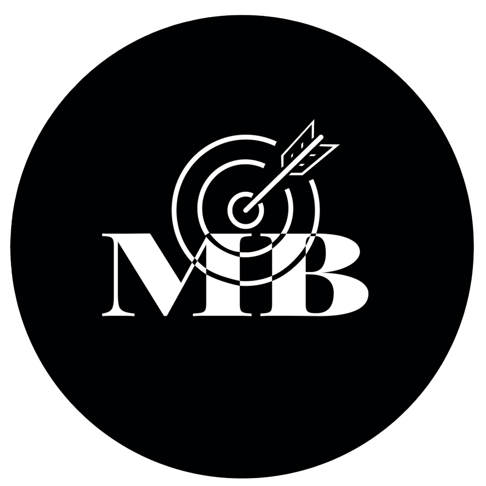

<h1 align="center">Baptiste Marchand</h1>

  

  Étudiant en bachelor développement à La Manu (Amiens). 
  J'aime coder, bidouiller et creuser, tout en cherchant à développer mes goûts. 

## Disponibilités

- **Stage (12 semaines) :** du 26 avril au 23 juillet 2027
- **Alternance (Rentrée 2027) :** rythme 3 semaines en entreprise / 1 semaine à l'école

## En ce moment

Je travaille actuellement sur une **Vitrine 3D - Kusmi Soda** :
> *Vitrine 3D interactive (Three.js / SCSS) mettant en valeur un design de packaging Kusmi Soda.*

- **Stack utilisée :** `JavaScript` · `Three.js` · `SCSS`
- **Lien :** [Voir le dépôt](https://github.com/MarchandBaptiste/Kusmi)

## Stack technique

**Frontend**

  

**Backend & Base de données**

  

**Outils, CMS & 3D**

  

- **Veille technique :** Architecture et outillage IA (serveurs MCP / *Model Context Protocol*), optimisation de workflow.

## Me contacter

  
  &nbsp;
  
  &nbsp;
  

